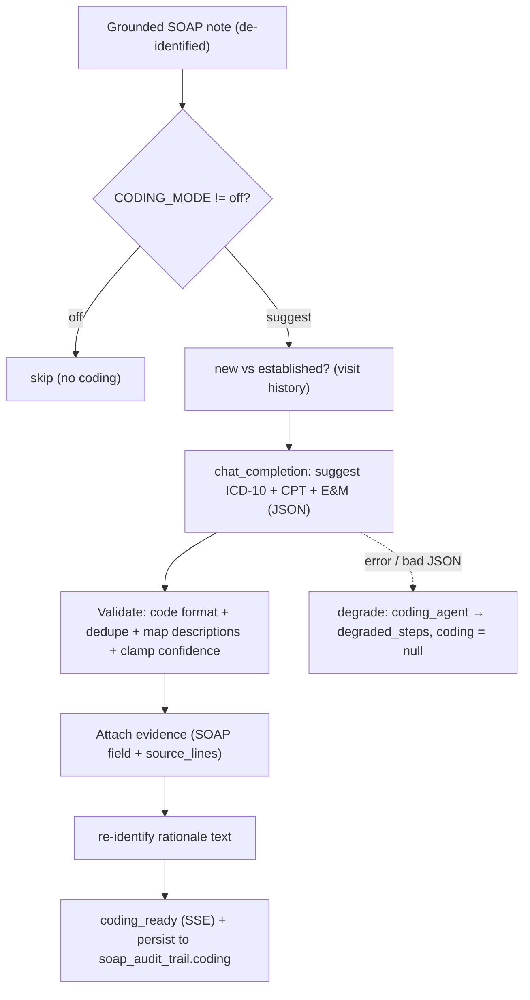

# Coding Agent — Technical Spec

*The first feature of **Phase 2 (get into the clinic)** from `BUILD_PLAN.md`. Suggests the billing/diagnosis codes a clinic needs to get paid — built on top of the now-trustworthy grounded SOAP note. Plain English, jargon explained.*

Last updated: 2026-06-15 · Companion to `BUILD_PLAN.md`, `GROUNDING_GATE_SPEC.md`, `DEID_SPEC.md`.

---

## 1. One paragraph (plain English)

After a visit, a clinic can't bill until someone turns the note into **codes**: a diagnosis code (ICD-10) for *what's wrong*, and a service code (CPT / E&M) for *what the doctor did*. Today a human does this by hand — slow, error-prone, and the #2 reason (after EHR write-back) clinics adopt or abandon a scribe. The **coding agent** is a new pipeline step that reads the finished SOAP note and **suggests** those codes, each with a plain-English description, a confidence score, and a link to the exact note text that justifies it. It never bills automatically and never blocks sign-off — it's an advisory assistant the doctor confirms. Because it reads the *grounded* note (claims already verified against the transcript), its suggestions inherit that trust, and because it runs after de-identification, no raw patient identifiers are needed to produce a code.

---

## 2. Jargon decoder

| Term | Plain meaning |
|---|---|
| **ICD-10** | The diagnosis code. "What condition does the patient have." E.g. `I10` = essential hypertension. |
| **CPT** | A procedure/service code. "What was done." E.g. `93000` = an ECG. |
| **E&M (Evaluation & Management)** | The CPT sub-family for office visits, billed by *complexity*. E.g. `99213` (established patient, low-moderate) vs `99214` (moderate). The single biggest billing decision for a normal visit. |
| **New vs established patient** | E&M codes differ for a first visit (`99202–99205`) vs a returning one (`99211–99215`). We already know this from the patient's visit history. |
| **Superbill** | The itemised list of codes a clinic submits to get paid. Our output is the raw material for one. |
| **Code description** | The human-readable name of a code, so the doctor isn't staring at `M54.5` but "Low back pain." |
| **Evidence link** | Which SOAP field + transcript lines justify a suggested code — the same idea as the grounding gate's `source_lines`. |
| **Advisory / suggestion-only** | The agent proposes; the provider disposes. Final coding responsibility is always the clinician's. |

> ⚠️ **Regulatory framing (non-negotiable in the UI):** AI-suggested codes are *advisory*. The provider is legally responsible for the codes they submit; this is not a substitute for a certified coder. Every surface that shows codes shows this disclaimer.

---

## 3. What exists today vs. the gap

**Already in place (we build on all of it):**
- A grounded SOAP note (`assessment` = the diagnosis text, `plan` = the service/disposition) with `source_lines` evidence per field.
- The exact agent pattern to copy: `services/compliance.py` already calls `chat_completion`, parses strict JSON, validates, and **degrades to a safe default** on any bad response — the coding agent is the same shape.
- A condensed ICD-10 reference already lives in `core/constants.py` (`ICD10_PRIMARY_CARE`) and is used by the compliance prompt.
- Pipeline plumbing for "run an agent, stream its event, re-identify, persist": `_maybe_call`, `_reid`, `bus.publish`, `soap_audit_trail`.
- Patient history (new vs established) is available — `trajectory`/history already read prior visits.

**The gap:** nothing turns the note into ICD-10 / CPT / E&M codes. `compliance.py` only *checks that a diagnosis is codeable*; it never emits the code.

---

## 4. Goals & non-goals

**Goals**
1. Suggest **ICD-10** diagnosis codes (from Assessment), **CPT** procedure codes (from Plan/Objective), and an estimated **E&M level** (new/established aware), each with description, confidence, and an evidence link.
2. Follow the established agent contract: one Groq call, strict JSON, **never raises**, degrades via `_maybe_call`, streams over SSE, persists with everything re-identified.
3. **Advisory only** — never blocks sign-off, never auto-submits. Strong disclaimer in the UI.
4. Reuse existing reference data and add a small CPT/E&M reference; **no new dependencies**.

**Non-goals**
- Not a certified encoder or a claims-submission integration (that's Phase 2's EHR/superbill export, later).
- Not a full ICD-10 catalogue (70k codes) — Phase A uses a curated primary-care set + the model's knowledge, validated against format.
- Not automatic modifier/units logic, NCCI edits, or payer-specific rules (future).

---

## 5. How it runs

A new **Step 5.5** (after compliance, which already establishes "is this codeable?"). It reads the de-identified SOAP note; like every step its output is re-identified before streaming/persisting.



**Why after compliance:** compliance already decided the Assessment is codeable and the Plan has a disposition; the coding agent turns that into actual codes without re-deriving it.

---

## 6. Data shapes (`backend/schemas/pipeline.py`)

```python
CodeSystem = Literal["ICD-10", "CPT", "E&M"]

class CodeSuggestion(BaseModel):
    system: CodeSystem
    code: str                       # e.g. "I10", "93000", "99214"
    description: str                # human-readable name
    confidence: float = Field(ge=0.0, le=1.0)
    evidence_field: SOAPFieldName | None = None   # which SOAP field justifies it
    evidence_lines: list[int] = Field(default_factory=list)  # transcript line_index refs
    rationale: str = ""             # one plain sentence ("documents essential hypertension")

class CodingResult(BaseModel):
    icd10: list[CodeSuggestion] = Field(default_factory=list)
    cpt: list[CodeSuggestion] = Field(default_factory=list)
    em: CodeSuggestion | None = None             # the single estimated office-visit level
    patient_class: Literal["new", "established"] = "established"
    checked_with: Literal["rules", "rules+llm"] = "rules+llm"
    disclaimer: str = (
        "AI-suggested codes are advisory. The provider is responsible for "
        "final code selection before billing."
    )

# PipelinePayload gains:
#     coding: CodingResult | None = None
```

- Mirrors `GroundingResult`/`DeidReport`: optional on the payload, persisted as JSON.
- `evidence_field`/`evidence_lines` reuse the grounding evidence idea so the UI can show "why this code."

---

## 7. The service (`backend/services/coding.py`)

Same skeleton as `compliance.py`:

```python
async def generate_codes(
    soap_note: SOAPNote, *, patient_class: str = "established"
) -> CodingResult: ...
```

- **Prompt (system):** "You are a medical coding assistant. From the SOAP note, suggest ICD-10 diagnosis codes (from Assessment), CPT procedure codes (from Objective/Plan), and ONE office-visit E&M level appropriate to the documented complexity for a {patient_class} patient. Output ONLY JSON. For each code give `code`, `description`, `confidence` (0–1), the SOAP `evidence_field`, and a one-sentence `rationale`. Do not invent procedures that aren't documented. These are advisory suggestions, not a final bill."
- **Reference context:** inject `ICD10_PRIMARY_CARE` (existing) + a new `CPT_EM_REFERENCE` block (below) to anchor the model, exactly as compliance injects its reference.
- **Validation (rules layer):** regex-check each code's format (ICD-10 `^[A-TV-Z]\d[0-9A-Z](\.[0-9A-Z]{1,4})?$`, CPT/E&M `^\d{4,5}$`), drop malformed entries, dedupe, clamp confidence to [0,1], and prefer the reference description when the code is known. E&M must be one of the valid office-visit codes for the `patient_class`.
- **Evidence:** default `evidence_field` to `assessment` for ICD-10 and `plan` for CPT/E&M; carry the model's pick when valid. `evidence_lines` copied from that SOAP field's `source_lines`.
- **Resilience:** never raises — returns `CodingResult()` (empty) on no-choices / empty / invalid JSON, same as compliance's `warn` fallback.

New reference constant in `core/constants.py`:

```python
CPT_EM_REFERENCE: Final[dict[str, str]] = {
    # Established patient office visit (most common in primary care)
    "99211": "Established patient, minimal (may not require physician)",
    "99212": "Established patient, straightforward",
    "99213": "Established patient, low complexity",
    "99214": "Established patient, moderate complexity",
    "99215": "Established patient, high complexity",
    # New patient office visit
    "99202": "New patient, straightforward",
    "99203": "New patient, low complexity",
    "99204": "New patient, moderate complexity",
    "99205": "New patient, high complexity",
    # A few common primary-care procedures
    "93000": "Electrocardiogram, complete",
    "36415": "Routine venipuncture (blood draw)",
    "90471": "Immunization administration",
    "94010": "Spirometry",
}
```

---

## 8. Pipeline integration (`backend/api/routes/pipeline.py`)

Add **Step 5.5** right after compliance, following the existing `_maybe_call` + `_reid` + `bus.publish` pattern:

```python
coding_result: CodingResult | None = None
if settings.CODING_MODE.strip().lower() != "off":
    coding_fn = _resolve("services.coding", "generate_codes")
    patient_class = "new" if await _is_first_visit(patient.id, db) else "established"
    coding_result = await _maybe_call(
        coding_fn, soap_note,
        patient_class=patient_class,
        default=None, label="coding_agent", degraded=degraded_steps,
    )
    await bus.publish(visit_id_str, EVENT_CODING_READY, {"coding": _reid(coding_result)})
```

- Runs on the de-identified `soap_note` (same object the other agents use); `_reid` restores any identifiers echoed in rationale text before streaming/persisting.
- **Persistence:** store under the existing JSONB audit column — `audit_trail["coding"] = _reid(coding_result)` — so **no DB migration** is needed (same precedent as grounding/deid). A dedicated `visit.billing_codes` column is a Phase B option (see §13).
- **`run-status` rehydration:** add `coding` to the recovery path that already rebuilds `grounding`/`deid` from `soap_audit_trail`.
- **Final payload:** add `coding=...` to the returned `PipelinePayload`.

New SSE constant: `EVENT_CODING_READY: Final[str] = "coding_ready"` (emit after `compliance_ready`, before `bias_ready`). Add `"coding_ready"` to `SSE_EVENTS` in `frontend/src/lib/sse.js`.

---

## 9. Config (`backend/core/config.py` + `.env.example`)

```python
# --- Coding agent (ICD-10 / CPT / E&M suggestions) ---
#   off     = skip entirely
#   suggest = generate advisory codes (default)
CODING_MODE: str = "suggest"
CODING_MODEL: str = "llama-3.3-70b-versatile"
CODING_MAX_CODES: int = 8          # cap ICD-10 + CPT suggestions to keep it focused
CODING_INCLUDE_EM: bool = True     # estimate the office-visit E&M level
```

Off-switch parity with the other gated steps; `suggest` is advisory and non-blocking, so it's a safe default — but see open decision #1 (cost).

---

## 10. Frontend (`SessionPage` + new `CodingPanel`)

- New **"Billing Codes (suggested)"** panel in the right rail / under the SOAP note. Hydrated from `visit.soap_audit_trail.coding` on load, from the `coding_ready` SSE event live, and from `run-status` on recovery — exactly how `grounding` is wired in `SessionPage`.
- Renders three groups: **Diagnosis (ICD-10)** chips, **Procedures (CPT)** chips, and the **Visit level (E&M)** with its description. Each chip shows `code · description`, a confidence dot, and on hover/expand the `rationale` + a link to the cited SOAP field (reusing the grounding flag styling).
- A persistent **advisory banner**: "AI suggestions — review and confirm before billing."
- **Degraded handling:** if `degraded_steps` includes `coding_agent`, show the existing partial-result treatment ("Coding unavailable for this note").
- Phase A is **read-only display**. Phase B adds per-code **Confirm / dismiss / edit** and writes accepted codes back via `/notes/save` (and into the signed record).

---

## 11. New/changed files

| File | Change |
|---|---|
| `backend/services/coding.py` | **New.** `generate_codes()` — prompt, Groq call, validation, evidence. |
| `backend/core/constants.py` | Add `CPT_EM_REFERENCE`; add `EVENT_CODING_READY`. |
| `backend/schemas/pipeline.py` | Add `CodeSuggestion`, `CodingResult`; `PipelinePayload.coding`. |
| `backend/core/config.py` + `.env.example` | Add `CODING_*` settings. |
| `backend/api/routes/pipeline.py` | Step 5.5 wiring, persist to `soap_audit_trail.coding`, `run-status` rehydrate, payload field. |
| `frontend/src/components/CodingPanel/CodingPanel.jsx` (+ `.css`) | **New.** Render code groups + disclaimer. |
| `frontend/src/pages/SessionPage/SessionPage.jsx` | `coding` state, `coding_ready` handler, hydrate/recover, render `CodingPanel`. |
| `frontend/src/lib/sse.js` | Add `coding_ready` to `SSE_EVENTS`. |
| `backend/tests/test_coding.py` | **New.** Service unit tests (mock `chat_completion`). |
| `backend/tests/test_pipeline_routes.py` | Assert `coding` present, event order, persistence, re-id. |

---

## 12. Testing plan

**Unit (`test_coding.py`, mock `chat_completion`):**
- Well-formed response → ICD-10 + CPT + E&M parsed, descriptions filled from reference, confidence clamped.
- Malformed codes (`"ABC"`, `"123"`) dropped; duplicates collapsed; `CODING_MAX_CODES` respected.
- E&M validated against `patient_class` (new → `9920x`, established → `9921x`).
- No choices / empty / invalid JSON → empty `CodingResult` (never raises).

**Integration (`test_pipeline_routes.py`):**
- `coding` present in the payload and `coding_ready` streamed after `compliance_ready`.
- `coding` persisted to `soap_audit_trail.coding` and rehydrated by `run-status`.
- De-id active: a name echoed in a rationale is restored in the doctor-facing output.
- `CODING_MODE=off` → no coding, no event, pipeline unaffected.

**Eval harness (later):** add a coding-accuracy metric (suggested vs gold codes) once we have a labelled set — natural extension of `backend/eval/`.

---

## 13. Phased delivery & magnitude

| Phase | Scope | Effort | New deps |
|---|---|---|---|
| **A (ship first)** | Schema + `coding.py` + reference data + pipeline Step 5.5 + persist + SSE + read-only `CodingPanel` + config + tests | Medium | **None** |
| **B** | Doctor **confirm/edit/dismiss**; persist accepted codes (optional dedicated `visit.billing_codes` column + Alembic migration); include in `/notes/save` and the signed record | Medium | — |
| **C** | **Export** — superbill view + feed accepted codes into the FHIR write-back (`DocumentReference` / `Claim`); ties into the Phase 2 EHR integration | Medium–High | EHR/FHIR work |

Phase A is self-contained, dependency-free, mirrors the compliance agent, and immediately gives the clinic the codes — the direct path to revenue.

---

## 14. Open decisions (need your call)

1. **Default `CODING_MODE`** — `suggest` (recommended; it's a headline Phase 2 feature) vs `off` (one fewer Groq call per run until you opt in).
2. **Persistence** — `soap_audit_trail.coding` (recommended; no migration) vs a dedicated `visit.billing_codes` column now (better for billing queries/export, but needs Alembic).
3. **E&M level** — include the estimated level (recommended, with the disclaimer) vs ICD-10/CPT only (E&M is the most liability-sensitive call).
4. **Code verification** — reuse a grounding-style LLM cross-check on each code now vs defer to Phase B (recommended: ship rules-validated Phase A first).
5. **Ship A then B/C** — recommend A first (advisory display), prove suggestion quality, then add accept/edit and export.

---

## 15. Bottom line

The coding agent is the first revenue-facing feature of Phase 2: it turns the trustworthy, grounded SOAP note into the ICD-10 / CPT / E&M codes a clinic bills on — advisory, evidence-linked, resilient, and built entirely on patterns we already ship (the compliance agent, the grounding evidence model, the de-id boundary). It's the bridge from "a note we can trust" to "a note that gets the clinic paid."
