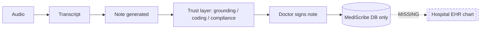
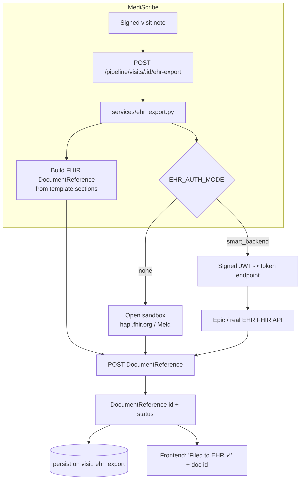

# EHR Write-Back — Technical Spec

*The **Phase 2 (get into the clinic)** headline feature from `BUILD_PLAN.md`: push the finished, signed note **into the hospital's existing records system** so the doctor never copy-pastes. Today the note lives only in MediScribe. This spec makes it file itself into any standards-compliant EHR. Plain English, jargon explained.*

Last updated: 2026-06-15 · Companion to `BUILD_PLAN.md`, `NOTE_TYPES_SPEC.md`, `CODING_AGENT_SPEC.md`, `GROUNDING_GATE_SPEC.md`, `DEID_SPEC.md`.

---

## 1. One paragraph (plain English)

Hospitals keep patient charts in an **EHR** (Electronic Health Record — Epic, Cerner/Oracle, athenahealth, etc.). Almost every modern EHR speaks a shared language called **FHIR** for reading and writing data. A clinical note, in FHIR, is a resource called a **`DocumentReference`** — basically an envelope with metadata (which patient, what kind of note, who wrote it, when) wrapping the note text. So "write-back" means: take a **signed** MediScribe note, package it as a `DocumentReference`, authenticate to the hospital's FHIR server, and `POST` it. The catch is auth: production EHRs require **SMART Backend Services** (a server-to-server OAuth handshake using a cryptographic key). We **don't have Epic credentials yet**, so Phase A builds and proves the entire create-and-file flow against a **free, open FHIR sandbox that needs no credentials**, with the EHR target chosen entirely by config. When Epic creds arrive, we paste four environment values and the *same* code files into Epic — no rewrite.

---

## 2. Jargon decoder

| Term | Plain meaning |
|---|---|
| **EHR** | Electronic Health Record — the hospital's system of record (Epic, Cerner/Oracle Health, athenahealth…). |
| **FHIR** | "Fast Healthcare Interoperability Resources" — the standard REST API EHRs expose. We target **R4**, the common version. |
| **Resource** | One FHIR object (a `Patient`, an `Encounter`, a `DocumentReference`). JSON over HTTPS. |
| **`DocumentReference`** | The FHIR resource for a clinical note: metadata + the note content as an attachment. This is what we create. |
| **LOINC** | A coding system that says *what kind* of note this is (H&P vs progress vs discharge). One code per note type. |
| **SMART on FHIR** | The healthcare flavour of OAuth 2.0 used to authorize apps against an EHR. |
| **Backend Services / client-credentials** | The "no human logged in" SMART flow for server-to-server jobs (exactly our case). The app proves itself with a **signed JWT**, not a password. |
| **JWT assertion** | A short-lived, cryptographically signed token our server generates with its **private key** to prove identity to the EHR's token endpoint. |
| **JWKS / JKU** | The public half of our key, published as JSON so the EHR can verify our signature. Epic (as of Feb 2026) requires a **JKU** (a URL serving the JWKS) for backend apps. |
| **US Core** | The US profile layer on FHIR that pins down required fields (e.g. a clinical-note `DocumentReference` must have `type`, `category`, `subject`, `date`, `author`, `content`). |

---

## 3. What exists today vs. the gap



Today a signed note stops at our database (`F`). The doctor still has to retype or copy-paste it into the real chart (`G`) — the exact manual work MediScribe is supposed to remove. **EHR write-back closes that last hop.**

---

## 4. Target architecture



**One service, two auth backends, chosen by env.** The FHIR mapping and the `POST` are identical regardless of target; only how we get an access token differs.

---

## 5. The FHIR `DocumentReference` mapping

A signed visit becomes one R4 `DocumentReference` (US Core "clinical-note" aligned):

| FHIR field | Source in MediScribe | Notes |
|---|---|---|
| `status` | constant `"current"` | The note is the live version. |
| `docStatus` | `"final"` (signed) | We only export signed notes. |
| `type` (LOINC) | from `note_type` template | New `loinc` field per template (see §6). |
| `category` | `clinical-note` (US Core) | Constant. |
| `subject` | the visit's `Patient` | Reference to a FHIR `Patient` (see §5.1). |
| `date` | `visit.signed_at` | When it was finalized. |
| `author` | the signing doctor (`User`) | Reference or `display` name. |
| `content[0].attachment.contentType` | `"text/plain"` (Phase A) | PDF/HTML later (Phase C). |
| `content[0].attachment.data` | base64 of the assembled note text | All sections rendered with their labels. |
| `content[0].attachment.title` | e.g. "History & Physical — 2026-06-15" | Template label + date. |
| `context.encounter` | *(optional, deferred)* | Phase C may create/link an `Encounter`. |

**LOINC by note type** (data-driven, added to `core/note_templates.py`):

| note_type | LOINC | Display |
|---|---|---|
| `soap` | `34109-9` | Note |
| `hp` | `34117-2` | History and physical note |
| `progress` | `11506-3` | Progress note |
| `discharge` | `18842-5` | Discharge summary |

### 5.1 Patient linkage

`DocumentReference.subject` needs a real FHIR `Patient` reference.

- **Open sandbox (Phase A):** **search-or-create** a `Patient` keyed by a deterministic identifier (`system = urn:mediscribe:patient-id`, `value = <our patient UUID>`). If found, reuse its FHIR id; else create from `full_name` / `dob` / `gender`. This makes export idempotent and gives a valid subject reference.
- **Real EHR (Phase B+):** the patient **already exists**; we must **match** (by MRN/identifier) rather than create. Epic patient-matching rules differ and are deferred to Phase B.

---

## 6. Configuration (all via `core/config.py`, env-driven)

Following the existing `*_MODE` pattern:

```text
EHR_EXPORT_MODE   = off | manual | auto       # default: off
    off    — feature hidden/disabled
    manual — doctor clicks "Send to EHR" (Phase A default once enabled)
    auto   — file automatically on sign-off (Phase C, opt-in)

EHR_AUTH_MODE     = none | smart_backend      # default: none
    none          — open sandbox, no token (HAPI/Meld)
    smart_backend — SMART client-credentials w/ signed JWT (Epic)

EHR_FHIR_BASE_URL = https://hapi.fhir.org/baseR4   # the FHIR R4 endpoint
EHR_TOKEN_URL     = ""                              # smart_backend only
EHR_CLIENT_ID     = ""                              # smart_backend only
EHR_PRIVATE_KEY   = ""                              # smart_backend only (PEM/JWK; SECRET)
EHR_JWKS_URL      = ""                              # smart_backend only (the JKU we publish)
EHR_SCOPES        = "system/DocumentReference.read system/DocumentReference.write"
EHR_REQUEST_TIMEOUT_SECONDS = 30.0
```

- `EHR_PRIVATE_KEY` is a **secret** — env/secret-store only, never logged, never committed. We generate the keypair; Epic only ever receives the **public** half (via `EHR_JWKS_URL`).
- Defaults ship **`off`** so nothing changes in prod until explicitly enabled.

---

## 7. Data model / persistence

**No migration** (matches the `coding_decisions` pattern). Store an `ehr_export` block inside the existing `visit.soap_audit_trail` JSONB:

```json
{
  "ehr_export": {
    "status": "filed",                       // none | filed | failed
    "document_reference_id": "DocumentReference/12345",
    "fhir_base_url": "https://hapi.fhir.org/baseR4",
    "exported_at": "2026-06-15T10:32:00Z",
    "exported_by": "<doctor uuid>",
    "patient_fhir_id": "Patient/678",
    "error": null
  }
}
```

*(Alternative considered: dedicated `visit.ehr_doc_id` / `ehr_status` columns — queryable but needs a migration. **Recommend JSONB now**, promote to columns later if we need to report on it.)*

---

## 8. API endpoint

```text
POST /pipeline/visits/{visit_id}/ehr-export
  auth:    require_doctor + ownership check
  guard:   visit.is_signed must be true  → else 409 "Sign the note before filing"
  guard:   EHR_EXPORT_MODE != off        → else 404 / 403
  body:    { "force": false }            // force re-file even if already filed
  200:     { status, document_reference_id, patient_fhir_id, exported_at }
  409:     not signed / already filed (unless force)
  502/504: EHR unreachable / rejected (with safe, non-leaky detail)
```

- **Idempotent:** if already `filed` and `force=false`, return the existing id (no duplicate).
- **Audit:** every export calls `log_phi_access` (the note + identifiers leave our system → must be auditable).
- Rate-limited via the existing `RATE_LIMIT_PIPELINE`.

---

## 9. Frontend

- On a **signed** note, show a **"Send to EHR"** button (only when `EHR_EXPORT_MODE != off`).
- States: idle → sending (spinner) → **"Filed to EHR ✓"** with the `DocumentReference` id → or an error with retry.
- Once filed, the button becomes a status chip ("Filed to EHR · DocRef 12345") with an optional "Re-file" (force) affordance.
- Reuse the existing toast + success-state patterns.

---

## 10. Security & PHI — important distinction

Unlike LLM calls, **the EHR is a trusted destination and the system of record.** So:

- **We send the REAL, re-identified note** (the full SOAP/H&P text with the patient's actual identifiers). De-identification **does not** apply here — the whole point is to file the true note into the chart.
- All transport is **HTTPS/TLS**.
- The private key is a **secret**; the signed JWT is **short-lived and single-use**.
- Every export is **audit-logged** (`log_phi_access`) with who/when/which visit/which destination.
- Only **signed** notes can be filed (no drafts leak into the chart).

---

## 11. Failure modes & resilience (graceful, per the house philosophy)

| Failure | Behaviour |
|---|---|
| EHR unreachable / 5xx | Retry with backoff (small, like `groq_retry`); on final failure, persist `status: failed` + `error`, return 502. Note stays safe in our DB. |
| Token request fails (smart_backend) | Surface a clear "EHR authentication failed" — never leak key/JWT detail. |
| Patient create/search fails | Abort the export with a specific message; nothing partially filed. |
| Already filed | Idempotent no-op (return existing id) unless `force`. |
| Feature off / not signed | Guarded at the endpoint; never reaches the EHR. |

---

## 12. Phases

| Phase | Scope | Unblocked by | Effort | Risk |
|---|---|---|---|---|
| **A** ✅ shipped | `DocumentReference` mapping + LOINC in templates + `services/ehr_export.py` (no-auth) + search-or-create Patient + endpoint + persistence + frontend button. | nothing | Medium | Low |
| **B** | SMART **Backend Services** auth (signed JWT, JWKS publishing) + Epic sandbox config + **patient identifier matching** + Epic-specific quirks. | Epic creds | Medium | Medium |
| **C** | `auto` mode (file on sign-off) + **PDF/HTML** attachment + `Encounter` linkage + versioning/replace + multi-EHR targets + write-back status dashboard. | — | Med | Low–Med |

### As-built notes (Phase A)

- **Endpoint lives in the notes router** (`POST /notes/ehr-export/{visit_id}`), not `/pipeline/...` as originally drafted — it's a post-sign action, so it sits beside `/notes/save` and `/notes/sign` and reuses their ownership + audit-trail patterns.
- **Auth:** `none` is fully implemented (open sandbox); `smart_backend` raises a clear "not yet implemented (Phase B)" error so selecting it fails loudly rather than silently.
- **Service** (`services/ehr_export.py`): pure `assemble_note_text` + `build_document_reference` (US Core clinical-note, LOINC per template), `_search_or_create_patient` (by `urn:mediscribe:patient-id` identifier), and `export_note` orchestration. All FHIR HTTP goes through the existing `call_with_retries` backoff policy.
- **LOINC** is data-driven in `core/note_templates.py` (`loinc()` helper): soap `34109-9`, hp `34117-2`, progress `11506-3`, discharge `18842-5`.
- **Persistence:** outcome (success *and* failure) is written to `visit.soap_audit_trail.ehr_export` (no migration), already surfaced by `VisitRead`. Idempotent: a `filed` visit returns the existing record unless `force=true`.
- **Audit:** every attempt calls `log_phi_access(action="ehr_export")`.
- **Gating:** `EHR_EXPORT_MODE` off by default → endpoint returns 403; only signed notes can be filed (else 409); failures persist `failed` and return 502.
- **Frontend:** a "Send to EHR" button on the signed card, gated by the `VITE_EHR_EXPORT_ENABLED` build flag (mirrors the backend default-off), with filing / filed (+ DocRef id) / re-file / error states.
- **Deferred to B/C as specced:** SMART JWT auth, Epic patient matching, PDF attachment, Encounter linkage, `auto` mode.

**Phase A delivers a working, demonstrable feature with zero external dependencies.** Phase B is a focused auth swap when creds land.

---

## 13. Open decisions (recommendations in **bold**)

1. **Open sandbox target for Phase A:** **HAPI public R4 (`hapi.fhir.org/baseR4`, no signup)** for fast iteration vs. Meld/Logica (free signup, more EHR-like). *Recommend HAPI first, keep it config so Meld is a one-line change.*
2. **Persistence:** **`ehr_export` block in `soap_audit_trail` JSONB (no migration)** vs. dedicated columns. *Recommend JSONB now.*
3. **Trigger:** **`manual` ("Send to EHR" button)** vs. `auto` on sign-off. *Recommend manual for A; auto is opt-in in C.*
4. **Attachment format:** **`text/plain` (assembled sections) for A** vs. PDF/HTML. *Recommend text/plain now, PDF in C.*
5. **Patient linkage:** **search-or-create by our UUID identifier (sandbox)** vs. require pre-existing match. *Recommend search-or-create for A; real matching in B.*
6. **Encounter:** **skip in A** vs. create/link. *Recommend defer to C.*

---

## 14. How we'll know it worked

- A signed H&P/progress/discharge/SOAP note files to the open sandbox and we can **GET it back** as a valid `DocumentReference` (correct `type`, `subject`, decoded text).
- Re-export is idempotent (no duplicates) unless forced.
- The visit shows **"Filed to EHR ✓"** with the returned id.
- An audit-log entry exists for every export.
- Unit tests (mapping → valid FHIR JSON), integration tests (mocked FHIR server: success / 5xx / already-filed / not-signed), and one **live sandbox round-trip** test (network-gated).
- SOAP-only behaviour and the rest of the pipeline are untouched.

---

## 15. Files this will touch (Phase A)

| Area | File(s) |
|---|---|
| Config | `backend/core/config.py` (EHR_* settings) |
| Templates | `backend/core/note_templates.py` (`loinc` per type + helper) · `frontend/src/lib/noteTemplates.js` (mirror, if UI needs it) |
| Service | `backend/services/ehr_export.py` (new): map + Patient search-or-create + POST + (stub) auth |
| Schema | `backend/schemas/pipeline.py` or a new `schemas/ehr.py` (request/response) |
| Route | `backend/api/routes/pipeline.py` (new `POST .../ehr-export`) |
| Persistence | write `ehr_export` into `visit.soap_audit_trail`; expose on `VisitRead` |
| Frontend | `SessionPage.jsx` ("Send to EHR" button + states) · `lib/api.js` (helper) · CSS |
| Tests | `backend/tests/test_ehr_export.py` (new) |
| Docs | this file · `BUILD_PLAN.md` (mark EHR write-back A as shipped) |
