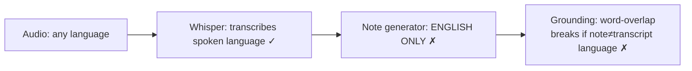
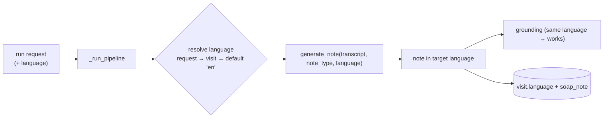

# Multilingual — Technical Spec

*The last open **feature** gap in `BUILD_PLAN.md` (§4): rivals advertise 28–80+ languages; we're English-only. This makes MediScribe work **end-to-end in any supported language** — non-English audio in, a clinically correct note in that same language out — with no new vendors (Groq Whisper already does multilingual ASR, LLaMA writes multilingual text). Plain English, jargon explained.*

Last updated: 2026-06-15 · Companion to `BUILD_PLAN.md`, `NOTE_TYPES_SPEC.md`, `GROUNDING_GATE_SPEC.md`, `DEID_SPEC.md`, `EHR_WRITEBACK_SPEC.md`.

> **Status: Phase A + B shipped.**
> **A** — each visit carries a BCP-47 `language` (default `en`); the note is generated in the visit's language while English output stays byte-for-byte unchanged. Whisper takes the language as an ASR hint, the FHIR `DocumentReference` carries `attachment.language`, and `SessionPage` shows a language selector.
> **B** — **cross-lingual** notes (speak X → note Y): Whisper's detected spoken language is stored on the visit (`transcript_language`, migration 004); when it differs from the note language the grounding gate switches from lexical word-overlap to the **LLM verifier as authoritative judge** (auto-enabled), degrading to "manual review" if the LLM is unavailable. De-id gains **localized month-name date** stripping (name + numeric scrubs were already language-agnostic), and the filed EHR document uses **localized section headers** (es/fr, English fallback). Full app-chrome i18n + CJK + per-language eval remain Phase C (see §12).

---

## 1. One paragraph (plain English)

A Spanish-speaking clinic records a Spanish visit. Today Whisper would transcribe the Spanish fine, but our note generator is hard-wired to write the note in English — so the doctor gets a mismatched, half-useful result, and our **grounding gate** (which checks the note against the transcript by word overlap) breaks because it's comparing English to Spanish. The fix is small and safe: treat **language as data**. Each visit gets a `language` (default `en`, so nothing changes for current users). Whisper already auto-detects and transcribes the spoken language; we tell the note generator to write **in that same language**; the trust layer keeps working because note and transcript are in the *same* language. Phase A is "MediScribe speaks language X," not "translate between languages" — cross-language translation (speak Spanish, file English) is the harder, later phase because it requires cross-lingual grounding.

---

## 2. Jargon decoder

| Term | Plain meaning |
|---|---|
| **ASR** | Automatic Speech Recognition — turning audio into text (Whisper). It already auto-detects language. |
| **BCP-47** | The standard short language code (`en`, `es`, `fr`, `pt-BR`). What we store on the visit. |
| **Transcript language** | The language actually spoken in the visit (what Whisper outputs). |
| **Note language** | The language the generated clinical note is written in. In Phase A this **equals the transcript language**. |
| **Grounding gate** | Our faithfulness check: each note sentence must overlap the transcript lines it cites. It compares words, so it needs note and transcript in the **same language**. |
| **Cross-lingual grounding** | Verifying a note in language Y against a transcript in language X. Needs the LLM verifier, not word overlap. Deferred to Phase B. |

---

## 3. What exists today vs. the gap



- **Already multilingual:** Whisper ASR + LLaMA diarization work on non-English audio today.
- **The gap:** the note generator's prompt forces English output; nothing carries a language choice; grounding assumes one language.

---

## 4. The three language axes (and what Phase A does with each)

| Axis | Phase A behaviour |
|---|---|
| **Spoken (transcript)** | Whisper **auto-detects** (optionally hinted by `visit.language`). Already works. |
| **Note output** | Generated **in `visit.language`** (= spoken language for the common case). |
| **UI / section labels** | Stay **English** in Phase A (UI localization is Phase C). The note *content* is translated; the field headings ("Assessment") are not yet. |
| **Patient-facing summary** | Out of scope here (it's the separate After-Visit Summary feature). |

---

## 5. The grounding constraint (the key design driver)

Grounding (`services/grounding.py`) scores a claim by the **fraction of its words found in its cited transcript lines**. This only works when the note and transcript share a language and a word-segmentation model.

**Decisions that follow:**
- **Phase A = note language equals transcript language.** Grounding stays valid with zero changes. This is the high-value, safe target (a clinic that operates in Spanish gets Spanish in, Spanish note, working trust layer).
- **Cross-language (speak X → note Y)** would silently fail lexical grounding, so Phase A **does not** offer it. When we add it (Phase B), we auto-enable the **LLM grounding verifier** (`GROUNDING_USE_LLM`), which is cross-lingual.
- **Word-segmentation caveat:** lexical overlap assumes space-delimited words. **Phase A targets space-delimited scripts** (Latin, Cyrillic, etc.). CJK (Chinese/Japanese/Thai) needs segmentation and is flagged as a later add-on.

---

## 6. Architecture / flow changes



Only the generator gains a `language` argument; everything downstream is language-agnostic or already works.

---

## 7. Configuration & storage

**Config** (`core/config.py`):
```text
DEFAULT_NOTE_LANGUAGE = "en"     # default for new visits; keeps everything unchanged
WHISPER_LANGUAGE_HINT = true     # pass visit.language to Whisper to improve accuracy
```

**Supported languages** live as **data**, not config — a small curated registry (`core/languages.py` + a frontend mirror `lib/languages.js`): `{code, label, native_label}` for an initial set (e.g. en, es, fr, de, pt, it, nl, pl, hi, …). One source of truth, mirrored like `note_templates`.

**Storage:** a new `visit.language` column (BCP-47, `nullable=False, default "en", server_default "en"`) via **migration `003_add_visit_language`** — same precedent as `note_type` (migration `002`). Queryable, so we can report "notes by language" later.

---

## 8. Generator changes (SOAP stays byte-for-byte identical for `en`)

`generate_note(transcript, note_type, language="en")` and `generate_soap(transcript, language="en")`:
- When `language == "en"`: use the **exact existing prompts** (the static `SYSTEM_PROMPT` and the template-built prompt) — so all current tests and output are unchanged.
- When `language != "en"`: **append** one instruction:
  > *"Write every `text` value in {Native language name} ({code}). Keep all JSON keys in English. Do not translate medical abbreviations that are conventionally left as-is."*
- `source_lines` logic, JSON shape, and validation are untouched.

---

## 9. Wiring

- `PipelineRunRequest.language: str | None` (like `note_type`) — optional per-run override.
- `VisitCreate.language: str = "en"` — set at visit creation (the selector).
- `_run_pipeline` resolves `language = request.language or visit.language or DEFAULT_NOTE_LANGUAGE`, normalizes it, passes to `generate_note`, and persists `visit.language`.
- `VisitRead.language` exposed so the editor reloads in the right language.
- **Whisper hint:** `transcribe()` gains an optional `language` param; when `WHISPER_LANGUAGE_HINT` and a non-auto language is known, pass it to Whisper for better accuracy (else keep auto-detect).
- **EHR tie-in (small):** set FHIR `DocumentReference.content[0].attachment.language = visit.language` in `ehr_export.build_document_reference`.

---

## 10. Frontend

- A **language selector** beside the existing note-type selector (`SessionPage`), populated from `lib/languages.js`, default English.
- Chosen language flows into visit creation / the run request and persists; on reload the note shows in its language (the editor already handles arbitrary UTF-8 text).
- Section **labels remain English** in Phase A; the note body is in the chosen language.

---

## 11. De-identification caveat (honest limitation)

De-id (`services/deid.py`) is rules-first: it strips the **patient's own name** (language-agnostic — it's a known string) and **numeric identifiers** (phones/SSN/MRN — mostly language-agnostic patterns). These keep working. What weakens for non-English:
- **Date phrasing** and **generic name detection** (the optional Presidio/spaCy NER ships an English model).

**Recommendation:** keep de-id **on** (the high-value patient-name + numeric stripping still fires), document the reduced date/NER coverage for non-English, and add **multilingual NER models** in Phase B.

---

## 12. Phases

| Phase | Scope | Effort | Risk |
|---|---|---|---|
| **A — ✅ shipped** | `visit.language` (migration 003) + language registry + generator `language` arg (en unchanged) + pipeline/visit/read wiring + frontend selector + Whisper hint + EHR attachment language. **Note language = spoken language.** | Medium | Low |
| **B — ✅ shipped** | **Cross-lingual** notes (speak X → note Y): `visit.transcript_language` (migration 004) from Whisper detection + auto-enabled **LLM-authoritative** grounding when note≠transcript language (graceful "manual review" degrade) + **localized de-id dates** (month names per language) + localized EHR section headers (es/fr) + cross-language grounding badge. | Medium | Medium |
| **C** | Full **UI localization** (i18n) + per-language **eval datasets** + CJK word-segmentation for grounding + RTL support + broader section-label + multilingual NER coverage. | Med–High | Med |

---

## 16. As-built notes (Phase B)

- **Spoken vs note language.** The selector picks the **note output** language; the **spoken** language is auto-detected by Whisper (`verbose_json.language`, mapped via `core/languages.canonical_language`) and stored on `visit.transcript_language`. Cross-lingual is simply *note ≠ spoken*; no second selector needed.
- **Cross-lingual grounding** (`services/grounding.py`): when cross-lingual, lexical overlap is bypassed and `_verify_cross_lingual` re-grades every *cited* claim with the LLM verdict applied **authoritatively** (it can both raise and lower a verdict, unlike the same-language downgrade-only Layer 2). Claims with no valid citation stay `ungrounded`; if the LLM is off/unavailable (`GROUNDING_CROSS_LINGUAL=false` or no Groq key), claims are flagged `partial` ("manual review") via `checked_with="crosslingual-unverified"`. Same-language path is unchanged.
- **`GroundingResult`** gains `cross_lingual: bool` and two new `checked_with` values (`llm-crosslingual`, `crosslingual-unverified`).
- **De-id dates** (`services/deid.py`): `_build_date_word_re(language)` merges English + the spoken language's month names (`core/languages.MONTH_NAMES`) and tolerates connector words ("15 **de** enero **de** 1980"). Name/numeric scrubs were already language-agnostic.
- **EHR** (`services/ehr_export.py`): `assemble_note_text(note_type, sections, language)` localizes section headers via `note_templates.section_labels(note_type, language)` (es/fr filled, English fallback).
- **Config:** `GROUNDING_CROSS_LINGUAL` (default true).

---

## 13. Open decisions (recommendations in **bold**)

1. **Scope of A:** **monolingual-per-visit (note = spoken language)** vs. cross-language translation now. *Recommend monolingual — keeps grounding valid; translation is Phase B.*
2. **Language storage:** **`visit.language` column + migration 003** (queryable, matches `note_type`) vs. stash in JSONB. *Recommend column.*
3. **`en` behaviour:** **keep the exact existing prompts for `en`** (zero regression) vs. always append a language line. *Recommend keep-unchanged for `en`.*
4. **Initial language set:** **a curated ~10–15 common languages** vs. exposing all ~99 Whisper languages. *Recommend curated list now (quality + tested), expand later.*
5. **Scripts:** **space-delimited scripts in A** (grounding works) vs. include CJK. *Recommend Latin/Cyrillic/etc. now; CJK in C.*
6. **Section labels:** **English labels in A** (content translated) vs. localize labels now. *Recommend English labels for A; localize in C.*

---

## 14. How we'll know it worked

- A Spanish (and one more, e.g. French) transcript produces a note **in that language**, and the grounding gate scores it normally (not all-flagged).
- `en` visits are byte-for-byte unchanged (generator output + all existing tests).
- `visit.language` round-trips through create → run → run-status → save → reload.
- The EHR `DocumentReference` carries the right `attachment.language`.
- De-id still strips the patient name + numeric identifiers in the non-English transcript.
- Unit test: non-`en` generator prompt contains the language instruction; `en` prompt is unchanged.

---

## 15. Files this will touch (Phase A)

| Area | File(s) |
|---|---|
| Migration | `backend/db/migrations/versions/003_add_visit_language.py` (new) |
| Model | `backend/models/visit.py` (`language` column) |
| Config | `backend/core/config.py` (`DEFAULT_NOTE_LANGUAGE`, `WHISPER_LANGUAGE_HINT`) |
| Languages | `backend/core/languages.py` (new) · `frontend/src/lib/languages.js` (mirror) |
| Generator | `backend/services/soap_generator.py` (`language` arg; en unchanged) |
| Transcription | `backend/services/transcription.py` (optional Whisper language hint) |
| Schemas | `backend/schemas/pipeline.py` (`PipelineRunRequest.language`) · `backend/schemas/visit.py` (`VisitCreate.language`, `VisitRead.language`) |
| Pipeline | `backend/api/routes/pipeline.py` (resolve + pass + persist language) |
| Visits | `backend/api/routes/visits.py` (set `language` on create) |
| EHR | `backend/services/ehr_export.py` (`attachment.language`) |
| Frontend | `frontend/src/pages/SessionPage/SessionPage.jsx` (+ CSS) language selector |
| Tests | `backend/tests/test_soap_generator.py` / new (prompt language), pipeline/visit round-trip |
| Docs | this file · `BUILD_PLAN.md` (mark Multilingual A) |
