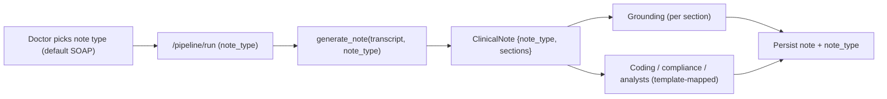

# Multiple Note Types — Technical Spec

*A **Phase 2 (get into the clinic)** feature from `BUILD_PLAN.md`. Today MediScribe only writes **SOAP** notes; rivals ship 6+ note formats. This adds a small, safe note-type system (SOAP + H&P + Progress + Discharge) without rewriting the pipeline, the trust layer, or the SSE/persistence flow. Plain English, jargon explained.*

Last updated: 2026-06-15 · Companion to `BUILD_PLAN.md`, `CODING_AGENT_SPEC.md`, `GROUNDING_GATE_SPEC.md`, `DEID_SPEC.md`.

---

## 1. One paragraph (plain English)

A SOAP note (Subjective / Objective / Assessment / Plan) is only one of several formats doctors use. A **new-patient or hospital visit** wants an **H&P** (History & Physical — chief complaint, history, exam, assessment, plan). A **follow-up** wants a short **Progress note**. A **hospital exit** wants a **Discharge summary** (diagnoses, hospital course, meds, follow-up). The content the AI extracts is the same; only the **section headings and emphasis** change. So instead of four hard-coded fields, we introduce a tiny **template registry**: each note type is just a named list of sections. The generator, the editor, and the trust agents all read sections from the template instead of assuming S/O/A/P. SOAP stays the default and behaves exactly as it does today, so nothing already shipped regresses.

---

## 2. Jargon decoder

| Term | Plain meaning |
|---|---|
| **SOAP** | Subjective, Objective, Assessment, Plan. Our current (and default) note. |
| **H&P (History & Physical)** | The thorough first-encounter note: Chief Complaint, History of Present Illness (HPI), Past Medical History, Review of Systems, Physical Exam, Assessment, Plan. |
| **Progress note** | A short interval-update note for a follow-up (often itself SOAP-shaped, but briefer). |
| **Discharge summary** | The end-of-hospital-stay note: admission/discharge diagnoses, hospital course, discharge medications, follow-up instructions. |
| **Section** | One labelled block of the note (e.g. "Assessment"). Each holds `text` + `source_lines` (the transcript lines that support it) — identical to today's `SOAPField`. |
| **Template** | A note type expressed as data: a key (`soap`), a label, and an ordered list of sections. Lives in one registry. |
| **note_type** | The chosen template for a visit (`soap` \| `hp` \| `progress` \| `discharge`). Stored on the visit. |

---

## 3. What exists today vs. the gap

**Already in place (we build on all of it):**
- A generic-enough section shape: `SOAPField {text, source_lines}` — every note type needs exactly this per section.
- A step-oriented pipeline (`pipeline.py`) that passes **one note object** to every agent — a clean seam.
- Grounding already has a per-field accessor (`_soap_field`) and per-field weights — generalises to per-section trivially.
- The agent contract (one Groq call, strict JSON, degrade via `_maybe_call`) is identical regardless of section names.

**The gap (the SOAP coupling we must break):**
- `SOAPNote` is a fixed 4-field Pydantic model; `SOAPFieldName` is a `Literal`. ~15 backend files and the frontend hard-code `subjective/objective/assessment/plan`.
- The generator prompt demands exactly those four keys.
- The frontend editor (`SOAPNote.jsx`) and `SessionPage` hard-code the field list, order, and save shape.

---

## 4. Goals & non-goals

**Goals**
1. Support **4 note types**: `soap` (default), `hp`, `progress`, `discharge`, defined in **one template registry** (backend constants, mirrored to the frontend).
2. Let the doctor **pick the note type** when starting a session; persist it on the visit (`visit.note_type`).
3. A **template-aware generator** produces the right sections; SOAP output is byte-for-byte unchanged.
4. The **trust layer keeps working** for every type: grounding verifies each section; coding/compliance read sections via a per-template mapping.
5. **Zero regression** for existing SOAP visits and **no new dependencies**.

**Non-goals**
- Not user-authored/custom templates (the 4 are built-in; custom templates are a later phase).
- Not specialty-specific variants (cardiology H&P, etc.).
- Not re-typing an existing signed note into another format.
- Not changing the analyst agents' *intelligence* — just what text they read.

---

## 5. Design — the tightest seam

### 5.1 Template registry (`backend/core/constants.py`)

One source of truth. Each template = key, label, ordered sections, and the per-template hints the trust agents need.

```python
NOTE_TEMPLATES: Final[dict[str, dict]] = {
    "soap": {
        "label": "SOAP note",
        "sections": [  # (key, label)
            ("subjective", "Subjective"),
            ("objective", "Objective"),
            ("assessment", "Assessment"),
            ("plan", "Plan"),
        ],
        "grounding_weights": {"assessment": 2.0, "plan": 2.0},
        "coding": {"dx_sections": ["assessment"], "px_sections": ["objective", "plan"]},
    },
    "hp":        {... chief_complaint, hpi, pmh, ros, exam, assessment, plan ...},
    "progress":  {... interval_history, exam, assessment, plan ...},
    "discharge": {... admission_dx, discharge_dx, hospital_course, discharge_meds, followup ...},
}
DEFAULT_NOTE_TYPE = "soap"
```

`SOAP_FIELDS` stays as an alias of the `soap` template's section keys for back-compat.

### 5.2 Generic note schema (`backend/schemas/pipeline.py`)

```python
class NoteSection(BaseModel):       # == today's SOAPField
    text: str = ""
    source_lines: list[int] = Field(default_factory=list)

class ClinicalNote(BaseModel):
    note_type: str = "soap"
    sections: dict[str, NoteSection] = Field(default_factory=dict)
```

- `SOAPNote` is **kept** and gains adapters: `ClinicalNote.from_soap()` / `.to_soap()` so the `soap` path and existing tests are untouched.
- `SOAPFieldName` widens to `str` (validated against the active template) — `GroundingClaim.field`, `CodeSuggestion.evidence_field`, `Differential.contributing_fields` become `str`. (Looser typing, validated at the template boundary instead of by `Literal`.)
- A shared helper `note_sections(note, template) -> list[(key, label, text, source_lines)]` replaces the duplicated 4-key loops everywhere.

### 5.3 Generator (`backend/services/soap_generator.py` → add `generate_note`)

`generate_note(transcript, note_type)` builds the system prompt from the template's sections (names + one-line guidance) and asks for exactly those JSON keys. `generate_soap` becomes a thin wrapper = `generate_note(transcript, "soap")`, so the AI-team symbol the route already resolves keeps working.

### 5.4 Trust + analyst agents (generalise, default unchanged)

- **Grounding:** iterate the template's section keys; weights from `template["grounding_weights"]` (default 1.0). SOAP result identical to today.
- **Coding:** prompt + `evidence_field` validation use `template["coding"]` (dx vs px sections). For `soap` the mapping reproduces current behaviour.
- **Compliance:** prompt lists the template's sections generically ("ensure each documented section is complete and codeable"). SOAP keeps its current checklist.
- **Differential / anomaly / bias / history / embedding / trajectory:** swap the hard-coded 4-key loop for `note_sections(...)`. Behaviour for SOAP is unchanged.

### 5.5 Persistence

- Add **`visit.note_type`** (string, default `"soap"`) — Alembic migration. The note body stays in the existing `soap_note` JSONB column (schemaless; we keep the column name to avoid a data migration). `note_type` is set at session start and returned in `VisitRead` + `PipelinePayload`.

### 5.6 Frontend

- A **note-type selector** at session start (defaults to SOAP).
- `SOAPNote.jsx` → generic **`ClinicalNoteEditor`** that renders the active template's sections (label + textarea + grounding chip), driven by a frontend mirror of the registry (`src/lib/noteTemplates.js`).
- `SessionPage` helpers (`EMPTY_SOAP`, `normalizeSoap`, `soapToRequest`, `staggerSoapFields`, bias-accept field search) become template-driven.
- `CodingPanel` / `DifferentialPanel` field labels read from the registry.

---

## 6. Data flow (unchanged shape, generalised content)



---

## 7. Phased delivery & magnitude

| Phase | Scope | Effort | Risk |
|---|---|---|---|
| **A** ✅ shipped | Template registry + `ClinicalNote` schema & adapters + `generate_note` + `visit.note_type` (migration `002`) + frontend selector & generic editor + grounding generalised + **SOAP unchanged**. New types render/generate/ground/store/display. | Medium–High | Medium (touches core schema) |
| **B** ✅ shipped | Per-template **coding + compliance** mappings so the trust agents read the real note sections (not the SOAP projection). | Medium | Low |
| **C** | Seed/eval/demo data per type; polish prompts per type; docs. | Low–Med | Low |

### As-built notes (Phase A)

- **No data migration**: the note body still lives in the `visit.soap_note` JSONB column as a flat `{section_key: {text, source_lines}}` map; `note_type` is a new column (migration `002_add_visit_note_type`). SOAP rows are byte-for-byte unchanged.
- **Grounding is fully generic**: it grades the real template sections; SOAP output is identical (verified by a `model_dump()` equality test).
- **Note type flows** via the run request (`PipelineRunRequest.note_type`) and visit creation (`VisitCreate.note_type`), is persisted on the visit, and round-trips through run-status / save / sign / reload (`PipelinePayload.note_type` + `note`, `VisitRead.note_type`).

### As-built notes (Phase B)

- **Coding** (`services/coding.py`): `generate_codes` accepts a `ClinicalNote` (or SOAPNote/dict). The prompt and `evidence_field` validation are built from the template's `coding.dx_sections` / `px_sections` and section labels; `evidence_lines` resolve from the real sections. SOAP output is unchanged (the SOAP template reproduces the old Assessment→ICD, Objective/Plan→CPT mapping).
- **Compliance** (`services/compliance.py`): `check` accepts a `ClinicalNote`. The SOAP path keeps the exact original `SYSTEM_PROMPT` + user message (so the HIPAA-prompt test still holds); other types get a generic prompt that lists their own sections and uses the dx/disposition section labels.
- **Pipeline + save**: both now pass the real `clinical_note` to coding and compliance (the SOAP projection is still used only for the *other* analyst agents — differential/anomaly/bias/history/embedding, which remain projection-based).
- **Still projection-based** (future work): differential, anomaly, bias, history retrieval, and embeddings read the SOAP projection.

Phase A is the bulk; B/C harden the trust layer for the new types and round out fixtures.

---

## 8. Open decisions (recommendations in **bold**)

1. **Schema:** generic `ClinicalNote` (sections dict) with `SOAPNote` kept as an adapter — **recommended** (least disruption, full back-compat) vs. a hard replacement of `SOAPNote` (cleaner but ripples through every test now).
2. **`note_type` storage:** dedicated **`visit.note_type` column + migration** (**recommended**, queryable) vs. stash inside JSONB (no migration, but unqueryable).
3. **Field typing:** widen `SOAPFieldName` → `str` validated against the template (**recommended**) vs. a big `Literal` union of every section key across templates.
4. **Note types in Phase A:** ship **all four** (`soap`, `hp`, `progress`, `discharge`) (**recommended** — they're just data) vs. SOAP + H&P only first.
5. **Coding/compliance for new types:** generalise prompts now (Phase A) vs. **defer full per-template mapping to Phase B** (**recommended**; in Phase A non-SOAP notes still generate, ground, store, and display — coding/compliance run in a generic mode and improve in B).

---

## 9. How we'll know it worked

- A doctor picks **H&P**, records, and gets an H&P-shaped note (CC / HPI / … / Plan), each section grounded against the transcript, editable, savable, signable.
- Every existing **SOAP** visit and test behaves exactly as before (zero regression).
- `visit.note_type` round-trips through run → save → sign → reload.

---

## 10. One-line summary

Turn the hard-coded 4-field SOAP note into a **template-driven section list** so MediScribe can write H&P, Progress, and Discharge notes — reusing the same generator, trust layer, and UI, with SOAP as the unchanged default.
